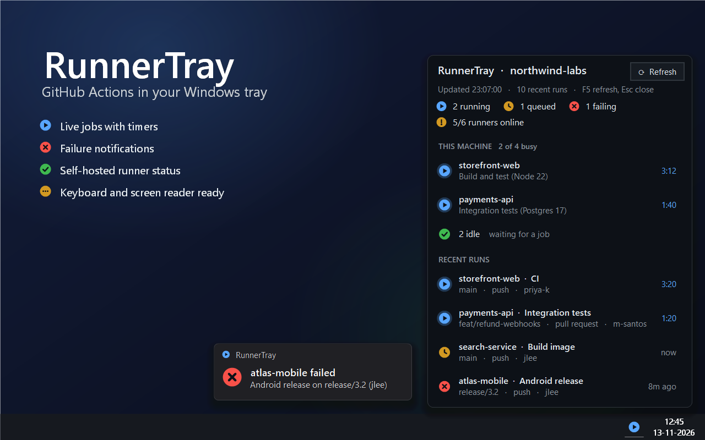
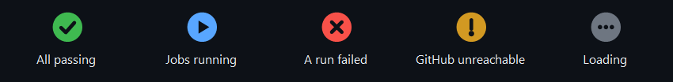
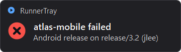
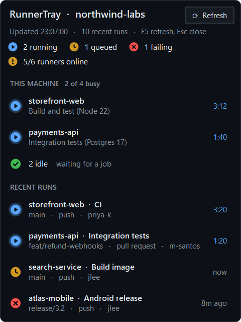
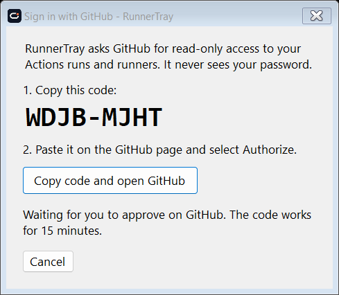
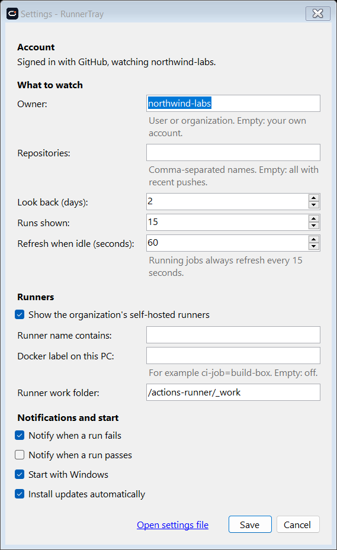

<p align="center">
  <picture>
    <source media="(prefers-color-scheme: dark)" srcset="assets/lockup-horizontal-reversed.png">
    
  </picture>
</p>
<h1 align="center">GitHub Actions status in your Windows system tray</h1>

<p align="center">
  <a href="https://github.com/azharudh33n/runner-tray/releases/latest"></a>
  <a href="https://github.com/azharudh33n/runner-tray/actions/workflows/build.yml"></a>
  <a href="https://github.com/azharudh33n/runner-tray/releases"></a>
  <a href="LICENSE"></a>
  
  
</p>

<p align="center">
  <a href="https://runnertray.wx8.org/download"><b>Download for Windows</b></a> ·
  <a href="https://runnertray.wx8.org/">Website</a> ·
  <a href="#sign-in">Sign in</a> ·
  <a href="#accessibility">Accessibility</a>
</p>



**RunnerTray** is a free, open-source **GitHub Actions monitor for Windows**. It lives in the
system tray and shows your **running, queued and failed workflow runs**, the status of your
**self-hosted runners**, and a **desktop notification when a build fails**, so you stop
refreshing the Actions tab. It works with personal accounts and organizations, signs in with
GitHub in under a minute, and uses read-only access.

The screenshots use made-up demo data (`RunnerTray.exe --demo`).

## Features

- **Tray icon that shows the state with a shape and a colour.** Check: all
  passing. Play: jobs running. Cross: the latest run of a workflow failed.
  Exclamation mark: GitHub cannot be reached.

  

- **Recent runs** across all your repositories (or a list you choose), with
  repository, workflow, branch, trigger, author, and age. Running jobs show a
  live timer. Click a run to open it on GitHub.
- **Self-hosted runners** of an organization: online, busy, or offline, with
  their labels.
- **This machine:** if your runners run in Docker containers on this PC,
  RunnerTray shows which repository and job each container is running, with a
  live timer.
- **Notifications** when a run fails (optional: when a run passes). Click the
  notification to open the run.

  

- **Sign in with GitHub** in under a minute: no terminal, no token to create.
- **Settings** and **Diagnostics** windows, automatic updates, and **Start with Windows**.



## Accessibility

RunnerTray follows [WCAG 2.2](https://www.w3.org/TR/WCAG22/) level AA where it
applies to a desktop app.

| WCAG | What RunnerTray does |
|---|---|
| 1.4.1 Use of colour | Every status has a shape (check, cross, play, clock, dash, exclamation mark) and words, not only a colour. |
| 1.4.3 Contrast (minimum) | All text has a contrast ratio of at least 4.5:1. Body text is 16:1, secondary text 6.1:1. |
| 1.4.11 Non-text contrast | Status badges and the focus ring have at least 3:1 against the background. |
| 1.4.4 Resize text | Follows **Settings > Accessibility > Text size** (up to 225%) and display scaling. |
| 1.4.10 Reflow | The summary line wraps when the text does not fit. |
| Windows high contrast | In high contrast mode (contrast themes), RunnerTray uses your system colours. |
| 2.1.1 Keyboard | Everything works with the keyboard (see [Keyboard](#keyboard)). |
| 2.4.3, 2.4.7 Focus order and focus visible | Focus moves top to bottom and has a clear ring. |
| 4.1.2 Name, role, value | Each row tells screen readers its status, repository, workflow, branch, and time, for example "Failed. atlas-mobile, Android release. release/3.2, push, jlee. 8m ago". |
| 2.2.2 Pause, stop, hide | Nothing flashes or animates. Only the timers count up. |
| 4.1.3 Status messages | Problems and sign-in progress are announced to screen readers. |

Every build runs [Axe.Windows](https://github.com/microsoft/axe-windows) on the panel, Settings, Sign in, and Diagnostics windows (0 errors required), and UI Automation tests that read every row the way a screen reader does.

### Keyboard

| Key | Action |
|---|---|
| Win+B, then arrow keys | Move to the RunnerTray icon in the tray |
| Shift+F10 or the Menu key | Open the menu, then select **Open** |
| Tab, Shift+Tab, Up, Down | Move between runs |
| Enter or Space | Open the selected run on GitHub |
| F5 | Refresh now |
| Esc | Close the panel |

## Install

1. Download `RunnerTray-win-Setup.exe` from the [latest release](../../releases/latest).
2. Run it. RunnerTray installs for your Windows user only (no administrator rights),
   adds itself to the Start menu, and starts. The icon appears in the tray. Windows can
   hide new tray icons behind the `^` arrow; drag the icon onto the taskbar to keep it
   in view.
3. Click the icon, then **Sign in with GitHub** (see below).

RunnerTray updates itself from GitHub Releases. Turn this off in **Settings**.
**Uninstall:** right-click the tray icon, then **Uninstall RunnerTray…**, or use **Settings > Apps >
Installed apps**. Both remove the app, your saved sign-in, Start with Windows, the cache and logs.
From the tray menu you can also remove your settings; Settings > Apps keeps them for a reinstall.

**Portable:** `RunnerTray-win-Portable.zip`. Extract it anywhere and run `RunnerTray.exe`. It updates
itself too. To remove it, right-click the tray icon, select **Remove RunnerTray…**, then delete the folder.

**Windows SmartScreen:** RunnerTray is not code-signed yet, so Windows may show
"Windows protected your PC" the first time. Select **More info**, then **Run anyway**.
You can check the download against the build log of the
[Release workflow](../../actions/workflows/release.yml), which builds it from this
source code.

Try it without a GitHub account: `RunnerTray.exe --demo`.

## Sign in



1. Click **Sign in with GitHub** in the panel (or right-click the icon, then **Sign in with GitHub**).
2. Select **Copy code and open GitHub**, paste the code on the GitHub page, and select **Authorize**.
3. To see an organization's repositories, select **Install** in the panel when RunnerTray
   asks, and choose the organization. An organization owner may have to approve it.

RunnerTray uses the [RunnerTray GitHub App](https://github.com/apps/runnertray). It can only
read, never change anything:

| Permission | Access | Used for |
|---|---|---|
| Actions | Read | Workflow runs |
| Metadata | Read | Repository names (required by GitHub) |
| Self-hosted runners (organization) | Read | Runner status; organization admins only |

Your sign-in is saved in Windows Credential Manager (encrypted for your Windows user) and
renewed automatically for up to 6 months. To sign out, right-click the icon, then
**Sign out**. To remove the access completely, also revoke it in
[GitHub > Settings > Applications](https://github.com/settings/apps/authorizations).

**Already use the GitHub CLI?** RunnerTray uses your `gh auth login` automatically if you have
not signed in, and also a `GITHUB_TOKEN` environment variable. For an organization's runner
list with the CLI, run `gh auth refresh -h github.com -s admin:org`.

## Use

| Action | Result |
|---|---|
| Left-click the tray icon | Open or close the panel (keyboard: see [Keyboard](#keyboard)) |
| Click a run | Open the run on GitHub |
| Click a busy runner on this machine | Open the repository's Actions page |
| **Refresh** in the panel, or F5 | Refresh now |
| Esc, or click elsewhere | Close the panel |
| Right-click the tray icon | Menu: refresh, sign in or out, open in GitHub, settings, diagnostics, start with Windows, update, exit |

When something is wrong, a message at the top of the panel says what and offers the fix:

| Message | What RunnerTray does |
|---|---|
| Sign in to GitHub | **Sign in with GitHub** button |
| Install RunnerTray on an organization | **Install** button |
| Offline | Shows the last data with its time; tries again with growing pauses, and at once when the network returns |
| GitHub rate limit reached | Waits until GitHub allows requests again |
| GitHub is having problems | Keeps trying; **GitHub status** button |
| The settings file has an error | Uses default settings until you fix it; **Open settings** button |

## Settings



Right-click the icon, then **Settings**. Changes apply at once. The settings are saved in
`%APPDATA%\RunnerTray\config.json`; if you edit that file by hand, RunnerTray reloads it.

| Setting | Default | Meaning |
|---|---|---|
| Owner | you | GitHub user or organization to watch. |
| Repositories | all | Names to watch. Empty: every repository with a push in the last *Look back* days (at most 40). |
| Look back (days) | 2 | How far back to look for active repositories. |
| Runs shown | 15 | Number of runs in the panel. |
| Refresh when idle | 60 s | While runs are active, RunnerTray refreshes every 15 s. After 30 quiet minutes, every 5 minutes. |
| Self-hosted runners | on | Show the organization's runners (organization admins only). |
| Runner name contains | all | Only show runners whose name contains this text. |
| Docker label on this PC | off | Label of runner containers on this PC, for example `ci-job=build-box`. Turns on **This machine**. |
| Runner work folder | `/actions-runner/_work` | Work folder inside those containers. |
| Notifications | failures | Notify when a run fails, passes, or both. |
| Start with Windows | off | Start RunnerTray when you sign in to Windows. |
| Install updates automatically | on | Installer and portable zip from a release. |

### Runner containers on this PC

If you run GitHub Actions runners in Docker on the same PC (for example with
[myoung34/docker-github-actions-runner](https://github.com/myoung34/docker-github-actions-runner)),
give the containers a label and enter it in **Docker label on this PC**. RunnerTray reads the
runner log (`Running job: …`) and the checked-out folder to show the repository and job,
every 5 seconds. Docker must be on your `PATH`.

## How RunnerTray uses the GitHub API

RunnerTray follows GitHub's [REST API best practices](https://docs.github.com/en/rest/using-the-rest-api/best-practices-for-using-the-rest-api):

- One request at a time, never in parallel.
- Conditional requests (ETags). When nothing changed, GitHub answers "304 Not Modified",
  which does not count against your rate limit. Most refreshes cost nothing.
- Obeys `retry-after`, `x-ratelimit-reset`, and `x-poll-interval`; backs off on errors.
- Pauses while your screen is locked or the PC sleeps.

**Diagnostics** (right-click the icon) shows the rate limit left, the number of requests and
cache hits, and recent errors. **Copy** puts the report on the clipboard for a bug report; it
contains no tokens.

## Privacy

Full details: [PRIVACY.md](PRIVACY.md). Security: [SECURITY.md](SECURITY.md).

RunnerTray talks only to `github.com` and `api.github.com`, and to your local Docker engine if
you turn that on. It sends no telemetry. On your PC it keeps: your sign-in (Windows Credential
Manager), settings (`%APPDATA%\RunnerTray`), and a cache, the last data, and logs
(`%LOCALAPPDATA%\RunnerTray-data`). Logs never contain tokens.

## Contributing

See [CONTRIBUTING.md](CONTRIBUTING.md) and the [Code of Conduct](CODE_OF_CONDUCT.md). Planned work: [ROADMAP.md](docs/ROADMAP.md).

## Build and test

Needs the [.NET 8 SDK](https://dotnet.microsoft.com/download/dotnet/8.0) on Windows.

```bash
git clone https://github.com/azharudh33n/runner-tray.git
```

```bash
cd runner-tray
```

```bash
dotnet build RunnerTray.sln -c Release
```

```bash
dotnet test RunnerTray.sln -c Release
```

```bash
dotnet run --project src/RunnerTray -- --demo
```

| Command | Purpose |
|---|---|
| `RunnerTray.exe --demo` | Made-up data, no account needed |
| `RunnerTray.exe --selftest` | Opens every window once and exits; exit code 0 means OK |
| `RunnerTray.exe --screenshot docs` | Renders the README images from demo data |

**Tests:** `tests/RunnerTray.Tests` covers the GitHub client, sign-in, settings, and every
failure in the table above with a fake GitHub. `tests/RunnerTray.UiTests` starts the real app
and checks it with UI Automation and Axe.Windows. Both run on every push, with CodeQL.

**Release:** push a tag such as `v1.0.1`. The [Release workflow](.github/workflows/release.yml)
tests, builds the installer and the portable zip with [Velopack](https://velopack.io), and
publishes the GitHub release that installed copies update from.

## Project layout

| Path | Contents |
|---|---|
| `src/RunnerTray.Core/ApiClient.cs` | GitHub REST client: request queue, ETag cache, rate limits, retries |
| `src/RunnerTray.Core/GitHubSource.cs` | Reads runs, repositories and runners |
| `src/RunnerTray.Core/DeviceFlow.cs` | Sign in with GitHub (device flow) |
| `src/RunnerTray.Core/SignedInTokenSource.cs` | Token storage and refresh |
| `src/RunnerTray.Core/PollPolicy.cs` | When to refresh |
| `src/RunnerTray/TrayApp.cs` | Tray icon, scheduling, notifications, menu |
| `src/RunnerTray/PopupForm.cs` | The panel |
| `src/RunnerTray/SignInForm.cs`, `SettingsForm.cs`, `DiagnosticsForm.cs` | Windows |
| `tests/` | Unit, scenario, UI and accessibility tests |

## License and trademarks

The source code is open source under the [MIT license](LICENSE).

The RunnerTray name and logos are trademarks of the RunnerTray project and are **not** covered by
the MIT license. You may use them to refer to RunnerTray and in unchanged copies of official
releases. A fork or changed version needs its own name and logo. Details:
[TRADEMARKS.md](TRADEMARKS.md) · Brand guidelines and logo files: [docs/brand](docs/brand/README.md) ·
Third-party licences: [THIRD-PARTY-NOTICES.md](THIRD-PARTY-NOTICES.md)

RunnerTray is not affiliated with GitHub, Inc. GitHub and GitHub Actions are trademarks of GitHub, Inc.