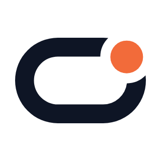
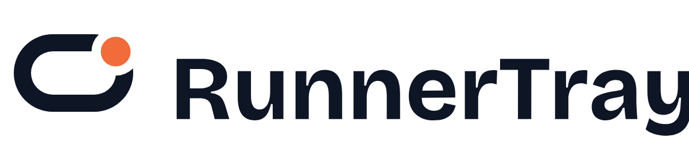
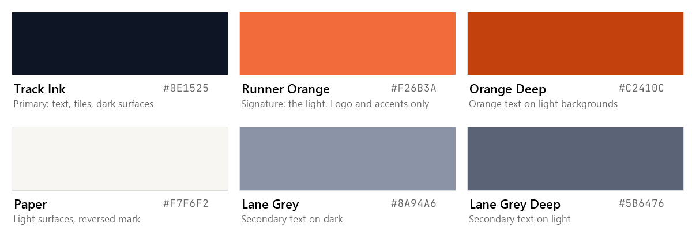
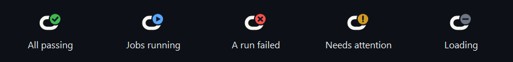

# RunnerTray brand guidelines

Version 1.0 · November 2026

These guidelines explain how to use the RunnerTray name, logo, colours and type. They apply to
the app, the website, documentation, and anything that talks about RunnerTray.

The RunnerTray name and logo are trademarks. See [TRADEMARKS.md](../../TRADEMARKS.md) for what you
may do with them. The source files are in [`assets/brand`](../../assets/brand) and are generated by
[`tools/brand/build-brand.ps1`](../../tools/brand/build-brand.ps1).

## 1. Who we design for

RunnerTray is used by **developers, DevOps and platform engineers** on Windows. They:

- live in dark IDEs, terminals and GitHub, and notice when a tool feels generic or noisy;
- want status at a glance, not another dashboard;
- trust tools that are precise, quiet, and honest about what they access.

So the brand is **calm, precise, technical and trustworthy**, with one warm signal: the runner.

| We are | We are not |
|---|---|
| Calm | Alarmist |
| Precise | Decorative |
| Technical, plain words | Jargon for its own sake |
| Honest about access and limits | Overpromising |

## 2. The mark: "Track"



**Idea:** a running track, the loop of continuous integration. The runner is a light breaking out
on the bend. In the app, the light shows the status of your builds.

| Part | Meaning |
|---|---|
| Track | The CI loop: push, build, test, repeat |
| Light | The runner, and the status signal in the tray |
| Gap round the light | The moment of attention: something is happening |

### Versions

| File | Use |
|---|---|
| `symbol.svg` | Default: Ink track, Orange light, on light backgrounds |
| `symbol-reversed.svg` | On dark backgrounds: Paper track, Orange light |
| `symbol-black.svg`, `symbol-white.svg` | One colour: print, engraving, single-colour contexts |
| `symbol-small.svg`, `symbol-small-reversed.svg` | Small cut for 16–32 px: thicker track, bigger light, wider gap |
| `app-icon.svg`, `app-icon-small.svg` | App icon: the mark on an Ink tile |
| `wordmark.svg` | The name alone |
| `lockup-horizontal.svg`, `lockup-horizontal-reversed.svg` | Symbol and name side by side: default lockup |
| `lockup-stacked.svg` | Symbol above the name: square spaces |
| `tray-<status>-<dark|light>.svg` | Tray icons, one per status and taskbar theme |




### Clear space and minimum size

- **Clear space:** keep a margin of at least **x** on every side, where x is the diameter of the light.
- **Minimum size:** symbol 16 px (use the small cut below 40 px); horizontal lockup 120 px wide;
  wordmark 80 px wide.

### Don't

- Don't change the colours, except to the one-colour or reversed versions.
- Don't rotate, stretch, outline, add shadows, glows or gradients to the mark.
- Don't move the light, close the gap, or replace the light with another shape.
- Don't use the status colours (green, blue, red, yellow) for the brand light outside the tray icon.
- Don't set the name in another typeface or recreate the wordmark with live text.
- Don't place the mark on busy photos or on colours with less than 3:1 contrast to the track.

## 3. Colour



| Name | HEX | RGB | Use | Contrast |
|---|---|---|---|---|
| Track Ink | `#0E1525` | 14 21 37 | Text, tiles, dark surfaces | 16.9:1 on Paper |
| Runner Orange | `#F26B3A` | 242 107 58 | The light; small accents | 6.0:1 on Ink, 3.0:1 on white (graphics only) |
| Orange Deep | `#C2410C` | 194 65 12 | Orange **text** on light backgrounds | 5.2:1 on white |
| Paper | `#F7F6F2` | 247 246 242 | Light surfaces; reversed mark | 16.9:1 on Ink |
| Lane Grey | `#8A94A6` | 138 148 166 | Secondary text on dark | 6.0:1 on Ink |
| Lane Grey Deep | `#5B6476` | 91 100 118 | Secondary text on light | 5.5:1 on Paper |

Why these colours: the track orange comes from real running tracks and stands apart from the blue
most developer tools use. Ink matches the dark editors our users work in.

### Status colours (reserved)

The app uses these for build status only, always with a shape and words (WCAG 1.4.1). They are not
brand colours.

| Status | HEX | Shape |
|---|---|---|
| Passed | `#3FB950` | Check |
| Running | `#58A6FF` | Play |
| Failed | `#F85149` | Cross |
| Needs attention / queued | `#D29922` | Exclamation mark / clock |
| Idle / cancelled | `#6E7681` | Dash |



## 4. Typography

All brand fonts are free under the SIL Open Font License.

| Role | Typeface | Use |
|---|---|---|
| Display | [Bricolage Grotesque](https://fonts.google.com/specimen/Bricolage+Grotesque) Bold / ExtraBold | Wordmark (outlined), headlines on the website and images |
| Text | [IBM Plex Sans](https://fonts.google.com/specimen/IBM+Plex+Sans) Regular / Medium / SemiBold | Website and document body text |
| Code and data | [JetBrains Mono](https://www.jetbrains.com/lp/mono/) Regular / Medium | Commands, versions, numbers in docs and on the website |
| In the app | Segoe UI (Windows system font) | All app text, so Windows text size, ClearType and screen readers behave as users expect |

The wordmark is Bricolage Grotesque Bold, converted to outlines. Never retype it.

## 5. Voice

Write the way the app behaves: short, plain and calm.

- Say what happened and what to do next: "Offline. Showing data from 12:41."
- Use the user's words: run, workflow, branch, runner. Not "pipeline execution entity".
- No exclamation marks in the product. No blame: "A run failed", not "You broke the build".
- Be honest about access: "Read-only. It cannot change your code."

## 6. Using the name

- Write **RunnerTray**: one word, capital R and T. Not "Runner Tray", "Runnertray" or "RT".
- RunnerTray is a product name. Use it as an adjective with a noun where it reads better:
  "the RunnerTray app".
- Projects built on RunnerTray's code must use a different name and logo (see TRADEMARKS.md).
- RunnerTray is not affiliated with GitHub, Inc. "GitHub" and "GitHub Actions" are trademarks of
  GitHub, Inc. Use them only to describe compatibility.

## 7. Regenerating the files

```bash
pwsh tools/brand/build-brand.ps1
```

```bash
pwsh tools/make-icon.ps1
```

The first writes the SVGs; the second renders PNGs, `assets/app.ico`, favicons, the installer splash,
and the tray icons embedded in the app.

The mark was designed with the open-source
[logo-design skill](https://github.com/kaankiziltug/logo-design-skill) process: brief, category
research, three concepts, small-size and one-colour tests, then refinement. A trademark search has
not been done; do one before registering the mark.
